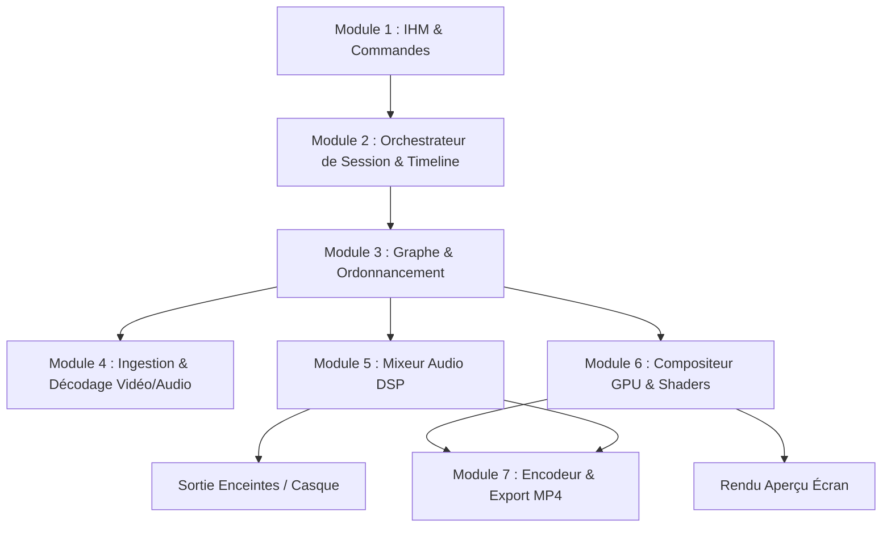
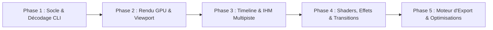

# Cahier des Charges Technique : Éditeur Vidéo Minimal Non-Destructif

Ce document définit les spécifications fonctionnelles et techniques pour la conception et le développement d'un éditeur vidéo de bureau minimaliste, performant et modulaire. L'architecture s'inspire directement des patrons de conception observés dans les moteurs de montage modernes haute performance : **séparation stricte données/moteur**, **précision temporelle absolue**, **rendu GPU modulaire** et **découplage complet de l'interface graphique**.

---

## 1. Vision Générale & Principes Directeurs

### 1.1 Objectif du Projet
Développer un éditeur vidéo de bureau multi-pistes (MVP), capable de :
1. Importer des médias (vidéo, audio, image) sans duplication physique.
2. Agencer ces médias sur une timeline multipiste avec découpe (In/Out), repositionnement, redimensionnement et réglage du volume.
3. Prévisualiser le montage en temps réel à 60 images par seconde avec une latence de *scrubbing* minimale.
4. Appliquer des transitions basiques et des effets de couleur (LUT / étalonnage) accélérés par GPU.
5. Exporter la composition dans un fichier conteneur (`.mp4`) en pleine résolution.

### 1.2 Principes Architecturaux Clés
* **Non-destructivité absolue** : Les fichiers d'origine sont uniquement ouverts en lecture. Le projet est un document déclaratif décrivant une succession d'opérations géométriques et temporelles.
* **Format normalisé et relationnel** : La timeline (`tracks` / `segments`) ne contient aucune métadonnée lourde. Elle pointe par des identifiants uniques (UUID) vers un référentiel d'actifs et de modificateurs (`materials`).
* **Unité de temps en microsecondes** : Tous les calculs temporels et horodatages sont stockés sous forme d'entiers 64 bits en microsecondes ($\mu\text{s}$, $10^{-6}\text{ s}$), éliminant tout artefact d'arrondi ou dérive de synchronisation audio/vidéo quel que soit le framerate (24, 25, 29.97, 30, 59.94, 60 fps).
* **Moteur agnostique de l'IHM** : Le cœur de traitement (décodage, composition, shaders, audio) est une bibliothèque autonome sans dépendance directe avec la bibliothèque graphique de l'IHM.

---

## 2. Spécification du Format de Données (`project.json`)

Le format de fichier de sauvegarde est un document JSON lisible et inspectable.

### 2.1 Structure Racine

```json
{
  "version": 1,
  "project_id": "3F2504E0-4F89-41D3-9A0C-0305E82C3301",
  "name": "Nouveau Projet",
  "create_time": 1775329130000000,
  "update_time": 1775329400000000,
  "duration": 60000000,
  "canvas_config": {
    "width": 1920,
    "height": 1080,
    "fps": 60.0,
    "ratio": "16:9",
    "background_color": "#000000"
  },
  "tracks": [],
  "materials": {
    "videos": [],
    "audios": [],
    "images": [],
    "effects": [],
    "transitions": [],
    "speeds": []
  }
}
```

### 2.2 Modèle des Pistes (`tracks`) et Segments (`segments`)

Une piste est une ligne temporelle ordonnée dédiée à un type de média :
* `type` : `"video"`, `"audio"`, `"effect"`.
* `layer_index` : Ordre d'empilement vertical (Z-order). Les index élevés se superposent aux index faibles.

Chaque segment sur une piste représente l'occurrence d'un clip :

```json
{
  "id": "A1B2C3D4-E5F6-7890-ABCD-EF1234567890",
  "material_id": "VID-UUID-001",
  "extra_material_refs": ["SPD-UUID-001"],
  "target_timerange": {
    "start": 5000000,
    "duration": 4000000
  },
  "source_timerange": {
    "start": 1000000,
    "duration": 4000000
  },
  "clip": {
    "transform": { "x": 0.0, "y": 0.0 },
    "scale": { "x": 1.0, "y": 1.0 },
    "rotation": 0.0,
    "alpha": 1.0,
    "flip": { "horizontal": false, "vertical": false }
  },
  "volume": 1.0,
  "speed": 1.0,
  "common_keyframes": [
    {
      "property": "scale.x",
      "curve": "Bezier",
      "keyframes": [
        { "offset": 0, "value": 1.0, "control_right": [0.42, 0.0] },
        { "offset": 2000000, "value": 1.25, "control_left": [0.58, 1.0] }
      ]
    }
  ]
}
```

### 2.3 Modèle du Référentiel Matériaux (`materials`)

Tous les objets porteurs de ressources ou de paramètres spécialisés résident dans `materials` :

```json
{
  "videos": [
    {
      "id": "VID-UUID-001",
      "path": "D:/Footage/clip01.mp4",
      "name": "clip01.mp4",
      "duration": 15000000,
      "width": 3840,
      "height": 2160,
      "fps": 59.94
    }
  ],
  "speeds": [
    {
      "id": "SPD-UUID-001",
      "mode": "constant",
      "speed_ratio": 1.0
    }
  ],
  "transitions": [
    {
      "id": "TR-UUID-001",
      "name": "CrossDissolve",
      "duration": 500000,
      "shader_name": "transition_fade.frag"
    }
  ]
}
```

---

## 3. Architecture Modulaire & Responsabilités

L'architecture est découpée en 7 modules autonomes à faible couplage :



### Module 1 : IHM & Couche Présentation
* **Technologie** : Tauri 2 (React + TypeScript) ou interface native.
* **Responsabilités** :
  * Affichage de la timeline, des pistes, des curseurs temporels et des panneaux d'inspecteur de propriétés.
  * Captation des interactions utilisateur (glisser-déposer, coupe avec outil rasoir, redimensionnement de clips).
  * Envoi de commandes déclaratives au moteur sans jamais manipuler directement les tampons mémoire de frames.
  * Hébergement de la surface de rendu native (viewport vidéo/canvas).

### Module 2 : Orchestrateur de Session & Modèle de Projet
* **Responsabilités** :
  * Gestion du cycle de vie du document (chargement, parsing JSON, sauvegarde atomique avec fichier `.bak`).
  * Implémentation du patron de conception **Commande (Command Pattern)** pour un historique Undo/Redo illimité.
  * Validation sémantique (interdiction des chevauchements sur une même piste sans transition explicite).
  * Notification d'événements de changement d'état via signaux / callbacks typés.

### Module 3 : Ordonnancement & Évaluation de la Timeline
* **Responsabilités** :
  * Pour un instant $t$ donné, calculer la liste ordonnée des segments actifs.
  * Évaluer les courbes d'animation par images-clés (interpolation polynomiale de Bézier cubique).
  * Calculer pour chaque clip la position d'échantillonnage exacte dans le fichier source :
    $$t_{\text{source}} = \text{source\_timerange.start} + (t_{\text{timeline}} - \text{target\_timerange.start}) \times \text{vitesse}$$
  * Produire un descripteur de trame (*Frame Render Plan*) transmis au compositeur.

### Module 4 : Ingestion & Décodage Média (Media Engine)
* **Technologie** : FFmpeg CLI / API (`libavformat`, `libavcodec`, `ffprobe`).
* **Responsabilités** :
  * Découverte des formats conteneurs, codecs, résolutions et fréquences d'échantillonnage.
  * Décodage asynchrone multithreadé : lecture en avance (*read-ahead*) et cache de trames pour garantir la fluidité.
  * Recherche par image clé (*keyframe seeking*) avec décodage des trames B/P intermédiaires pour un positionnement exact (*frame-accurate seek*).

### Module 5 : Mixeur Audio & DSP
* **Responsabilités** :
  * Horloge maîtresse (*Master Clock*) du lecteur : la lecture audio cadence l'horloge temporelle globale pour éviter tout décalage lèvre-voix (*lip-sync*).
  * Mixage sommatoire pondéré par clip avec calcul des rampes de volume linéaires ou logarithmiques pour les fondus.

### Module 6 : Compositeur GPU & Pipeline de Shaders
* **Responsabilités** :
  * Gestion de la chaîne de rendu par calque (*Render Targets* / canvas).
  * Application de la matrice de transformation 2D de chaque clip (translation, échelle, rotation normalisée).
  * Application des shaders d'effets (étalonnage couleur, masques, filtres) et des transitions.
  * Présentation finale dans la texture partagée du Viewport de l'IHM.

### Module 7 : Transcodage & Exportation
* **Responsabilités** :
  * Itération séquentielle hors-ligne temps-constant de la timeline ($t = 0 \to \text{duration}$ par pas de $1/\text{fps}$).
  * Rendu de chaque frame à résolution nominale (ex. 1080p ou 4K).
  * Encodage vidéo H.264 / HEVC matériel ou logiciel et audio AAC via FFmpeg.
  * Multiplexage du conteneur final `.mp4`.

---

## 4. Protocoles de Communication & Synchronisation

1. **Horloge Principale et Synchronisation A/V** :
   * L'horloge de référence est pilotée par le flux de lecture de la carte son (*Audio Callback*).
   * À chaque demande de remplissage du tampon audio, l'horloge système $t$ avance. Le moteur vidéo interroge cette horloge pour déterminer quelle frame afficher.
   * Si le décodage vidéo prend du retard par rapport à l'horloge audio, la stratégie est le *frame-dropping* (saut de trames vidéo) pour maintenir l'alignement absolu.

2. **Communication IHM $\leftrightarrow$ Moteur** :
   * Communication asynchrone non-bloquante : l'IHM n'attend jamais la fin d'un décodage pour rester fluide.
   * Le moteur émet des événements (ex: `FrameReady(texture_id)`, `PlaybackPositionChanged(uint64_t microsec)`).
   * L'IHM émet des commandes immuables (ex: `SeekTo(microsec)`, `SplitClip(clip_id, microsec)`, `SetVolume(clip_id, float)`).

---

## 5. Feuille de Route & Ordre de Développement (Phasage)



### Phase 1 : Cœur de Données & Décodeur CLI (Semaines 1 à 3)
* Définir les structures de données (`Project`, `Track`, `Segment`, `Material`).
* Implémenter le sérialiseur/désérialiseur JSON avec tests unitaires automatisés.
* Intégrer FFmpeg / FFprobe pour charger une vidéo, ouvrir le flux, extraire les métadonnées et décoder une frame arbitraire à un timecode précis.

### Phase 2 : Rendu GPU & Affichage Temps Réel (Semaines 4 à 6)
* Mettre en place le contexte graphique d'affichage.
* Créer le compositeur de textures : superposer les calques et appliquer les matrices de transformation 2D.
* Intégrer le moteur audio avec synchronisation d'horloge.

### Phase 3 : Timeline Multipiste & Interface Graphique (Semaines 7 à 10)
* Développer l'interface graphique : panneau d'importation des médias, timeline interactive avec pistes horizontales, zoom temporel et tête de lecture.
* Implémenter le patron Commande pour les actions d'édition (découper, déplacer, redimensionner, supprimer).

### Phase 4 : Pipeline d'Effets & Transitions (Semaines 11 à 13)
* Développer les filtres de post-traitement de base (couleur, étalonnage).
* Implémenter la gestion des transitions entre clips consécutifs.
* Implémenter le moteur d'interpolation d'images-clés pour animer la position et l'opacité.

### Phase 5 : Exportation, Optimisation & Finalisation (Semaines 14 à 16)
* Développer la boucle d'exportation hors-ligne : rendu image par image à pleine résolution.
* Intégrer l'encodage H.264/AAC et le multiplexage conteneur MP4 via FFmpeg.
* Optimisations de performance (cache LRU, pré-décodage en arrière-plan).

